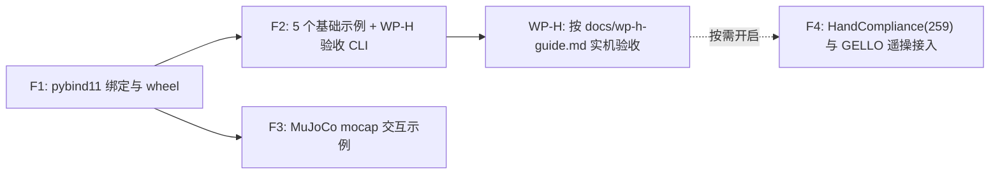

# Panthera 双臂空间控制 SDK：二期执行计划（WP-F / MuJoCo 示例 / WP-H 工具 / GELLO 承载）

本文承接 [PLAN.md](PLAN.md)（v4.1），作为下一阶段交给执行 agent 的计划来源。**前置基线（WP-A/B/C/D/E/G）已全部完成并通过 9/9 CTest（HPIPM p99 ≈ 73 µs）**；本阶段补齐尚未实现的 **WP-F**，同步提供 **MuJoCo mocap 交互示例** 与 **WP-H 实机验收脚本**，并明确 **PC 端双 GELLO 遥操** 的承载边界。

> 遵循 [PLAN.md](PLAN.md) §1 全部已拍板决策，不修改 §1；涉及安全边界、实机动作或跨平台 ABI 变更的未决项须由负责人确认，其余按工作包验收条件推进。

---

## 1. 现状核对与范围约束

### 1.1 已核实代码基线
- C++ 核心 API 见 [controller.hpp](../include/panthera/controller.hpp)、[session.hpp](../include/panthera/session.hpp)、[telemetry.hpp](../include/panthera/telemetry.hpp)、[geometry.hpp](../include/panthera/geometry.hpp)。实际 C++ 入口为 `DualArm(BoardAddress left, BoardAddress right, ControlConfig config)`（非草案中的 YAML 工厂）。
- `CMakeLists.txt` 已接入 `third_party/pybind11`（v3.1.0）并启用 `CMAKE_POSITION_INDEPENDENT_CODE ON`；Windows CI（[.github/workflows/host.yml](../.github/workflows/host.yml)）使用 **MSYS2 UCRT64**（GCC + `mingw-w64-ucrt-x86_64-python`）。
- 协议代码 [robot_messages_values.h](../generated/protocol/robot_messages_values.h) 已生成 `hand_compliance_command_value_t`（ID 259）；当前 [session.cpp](../src/session.cpp#L111) 与 [sim/session.py](../sim/session.py#L133) 仅使用 `hand_mode = 2` 与 `HandCommand`（ID 258）。
- 固件目录 [firmware/](../firmware/README.md) 已完整保留 `source/src/{gello,standalone}` 与 `boards/gello-*.conf`（D7），默认交付构建通过 `host-control.conf` 显式关闭 `GELLO_USB`/`GELLO_UART`。
- 模型 [panthera_dual_a2l1.urdf](../model/panthera_dual_description/urdf/panthera_dual_a2l1.urdf) 中臂部 `<visual>` 使用 `.glb`（MuJoCo 不原生支持），`<collision>` 使用 `.STL`，手部使用 `.obj`，且包含 10 个 `<mimic>` 关节。

### 1.2 克制原则
1. **不改已验收的 C++ 控制器与 QP 行为**（F1 可在既有接管等待循环增加可选取消检查，取消沿用租约回滚；其余为绑定、打包、示例与仿真适配层）。
2. **`mujoco` 与 GELLO 硬件驱动不进入核心 SDK 运行时依赖**：`mujoco` 作为 Python optional extra（`[mujoco]`）；GELLO 驱动不进 `include/`/`src/`/`python/panthera_sdk/`。
3. **所有示例与验收脚本默认不触碰实机**：默认 `--loopback`（或只读），连接实机必须显式传入 `--real`；专家模式连接实机须额外传入 `--i-understand-no-safety`。

---

## 2. 工作包（尽量精简，按依赖并行）

| WP | 内容 | 验收标准 |
| --- | --- | --- |
| **F1** Python 绑定与 wheel（依赖：已有 E） | 新增 `pyproject.toml`（`scikit-build-core`）、`python/panthera_sdk/{__init__.py, _core.cpp, _core.pyi}` 与 CMake 选项 `PANTHERA_BUILD_PYTHON`。 • 1:1 绑定 `DualArm`（支持 `with` 上下文管理器）、`BoardTelemetry`（供只读 500 Hz 监测）、`Side`、`ExpertAck`、`RealtimeAddress`、`BoardAddress`、`MotionBounds`、`ControlConfig`、`ControlState`、`BoardState`、`RpcTiming`、`ArmGeometry`、`CollisionState`、`arm_geometry`、`collision_state`（只读返回 `closest`/`inter_arm`/`hard_margin`/`pair`，避免用含同臂 6.523 mm 近距对的 `ControlState.clearance` 冒充臂间距离）、`default_bounds`。 • **遥测快照安全**：`BoardTelemetry.poll()` 为单持有者非阻塞接口，Python 绑定在持有 GIL 时拷贝返回独立快照，完整暴露 F2 所需的 `received_at`、`received`、`missing`、`q_rad`/`dq_rad_s`/`feedback_age_us`/`fault_code_raw`/`control_owner`/`policy_revision` 及 `boot_id`/`restarts`/`encoder_jumps`。 • 位姿用 `numpy` `4×4 float64` 矩阵（校验有限值、底行 `[0,0,0,1]` 及正交右手系），关节/速度用 `numpy` 向量。 • **GIL 与信号中断**：`DualArm.enable`、`DualArm.soft_stop`、`~DualArm` 释放 GIL；等待接管期间分段轮询并检查 `PyErr_CheckSignals()`，保证主线程能及时响应 `SIGINT`。 • 扩展 CI：Linux x86_64 与 Windows x64（**本期 Windows wheel 明确交付 MSYS2 UCRT64 Python，与现有 CI 工具链一致，不扩大到 MSVC 移植**）构建安装 wheel 并跑 Python 回环测试。 | 1. Linux x86_64 与 Windows x64（MSYS2 UCRT64 Python）CI 均能构建并安装 `panthera_sdk` wheel。 2. `tests/test_python_sdk.py` 对 `sim/motion.py` 跑通 `enable` → `set_pose_target` / `set_twist_target` / `set_joint_target` / `set_hand_target` / `state` / `collision_state` / `soft_stop` / `enter_expert_mode` / `BoardTelemetry` 独立快照读取。 3. 非法输入（非正交矩阵、NaN、维度错误）抛 `ValueError`；子进程测试在等待接管期间发送 `SIGINT`，在 ≤ 1 s 内退出并完成租约清理/软停，不挂死。 |
| **F2** 基础示例与 WP-H 验收 CLI（依赖：F1） | 1. 补齐 `PLAN.md` WP-F 规定的 5 个 Python 示例（均支持 `--loopback` / `--real`）：    - `examples/read_state.py`（500 Hz 只读时延/丢包与零位整圈分支统计）    - `examples/cartesian_move.py`（双臂笛卡尔往返）    - `examples/approach_stop.py`（双臂对向靠近自停在 `d_s = 20 mm` 外）    - `examples/hand_passthrough.py`（6 主动手关节透传与反馈读回）    - `examples/expert_mit.py`（专家模式直通演示，显式安全确认） 2. 新增单一实机验收入口 `examples/wp_h_accept.py`，子命令一一对应 [wp-h-guide.md](wp-h-guide.md) Stage 1–6：`stage1-telemetry`、`stage2-takeover`、`stage3-single-joint`、`stage4-hand`、`stage5-approach`、`stage6-soak`。内置保守初速（`max_speed=0.25 rad/s`、`translation_speed=0.05 m/s`），支持 `--smoke`（短回环回归模式）与 `--real`。    - **Stage 2 断链记录**：按 [PLAN.md §3.1](PLAN.md#L69) 分别记录主机冻结时刻（10 ms）、主机停发并请求 `op18` 时刻（50 ms）及可确认的板端结果；失联侧缺少反馈时记为 `unconfirmed`（不强行断言 50 ms 内双板均已入 `HOME_SOFT_HOLD`）。    - **防假通过与报告留痕**：运动子命令须校验实际反馈到位或确实靠近自停，超时/未到位/非预期故障一律返回非零退出码；落盘 `validation/<YYYYMMDD>/` 的 JSON/CSV 明确写入 `run_mode`（`smoke_loopback`/`real`）与 `actual_duration_s`，现场人工核对项（手指符号/端点、物理实测间隙、转接件尺寸质量）固定标记 `pending_human_confirmation`。默认 `--loopback`，未传 `--real` 不绑定 `192.168.10.1`。 3. 更新根 `README.md` 补齐 Python 安装说明（写明 Windows wheel 适用于 MSYS2 UCRT64 Python）与示例入口。 | 1. 自动化回归（纳入 CTest/CI）对 `sim/motion.py` 跑通 5 个基础示例与 `wp_h_accept.py --smoke` 全部 6 个子命令：运动项须断言实测反馈到位（例如 `stage2-takeover` 在 `--smoke` 下给足抬臂时长或小幅抬升目标并断言到达，不得未动即过），异常/超时返回非零。 2. 验证生成的报告含 `run_mode=smoke_loopback`、`actual_duration_s` 与 `pending_human_confirmation`，不会将短回环记成 1 小时实机拷机通过。 3. 未传 `--real` 时不绑定 `192.168.10.1`。 |
| **F3** MuJoCo 拖 mocap 双臂 QP 交互示例（依赖：F1，可与 F2 并行） | 1. `pyproject.toml` 增加可选依赖 `[project.optional-dependencies] mujoco = ["mujoco>=3.2"]`。 2. 新增离线场景生成脚本 `tools/sim/build_mujoco_scene.py`，从 `model/panthera_dual_description/urdf/panthera_dual_a2l1.urdf` 生成并提交 `sim/assets/panthera_dual_mocap.xml`：    - 臂连杆改引用 `meshes/panthera_ht/stl/*.STL`（避开 MuJoCo 不支持的 `.glb`），手部引用 `meshes/a2l1_hand/collision/casbot_hand/*.obj`（直接相对路径，不复制网格）。    - 为 10 个 mimic 关节加 `<equality><joint>`；12 个臂关节配 `<motor>`，消费 `ArmCommand` 中的 `τ_ff` 按 MIT 公式 `τ = kp(q_ref−q) + kd(dq_ref−dq) + τ_ff` 驱动；手部 6 主动关节配位置伺服。    - 默认关闭连杆间碰撞接触（`contype=0 conaffinity=0`）防止 `zero`/`ready` 物理卡死；加入左右 2 个可拖拽 `mocap` 目标体（`left_target`/`right_target`，默认初始化在 `ready` 对应 TCP 位姿，支持 `--start-zero`）。 3. 新增 `sim/mujoco_board.py` 与 `examples/mujoco_mocap_qp.py`：    - **共享单物理场景**：左右两个 `SessionBoard` 端点共享同一份双臂 `MjModel`/`MjData`，每个物理子步（`≤ 1 ms`）仅推进一次 `mj_step`，保持既有 wirelink UDP 协议、接管与看门狗。    - 主循环持续将左右 mocap 位姿喂给 `set_pose_target`，并用 F1 绑定的 `collision_state` 从实测关节角计算并打印 `inter_arm`、`closest`、`hard_margin` 与 `qp_time`；提供 `--headless` 模式供自动化回归。 | 1. 在安装了 `mujoco` 的环境中执行重力独立校验：在 `dq = 0`、手指固定中立位（`q_hand = 0`，对齐 `PLAN.md §3.1`）下对多组姿态逐轴比对 `arm_geometry(side, q).gravity` 与 MuJoCo 静力重力项 `qfrc_bias`，核对符号、轴序与惯量转换一致（误差 `< 1e-3 N·m`）。 2. 运行 `python3 examples/mujoco_mocap_qp.py --headless`：    - MJCF 加载无报错；单臂目标跟踪稳态 TCP 位置误差 `< 5 mm`；    - 程序化将左右 mocap 移向中平面交叉后，通过 `collision_state` 验证**确实靠近且安全停稳**：全过程最小 `inter_arm < 40 mm` 且全程 `inter_arm ≥ 19 mm`、`hard_margin > 0`，终态关节速度趋零（`‖dq‖ < 0.02 rad/s`）且 `enabled == True`、`error == ""`。 3. 桌面运行可见双臂位于 `ready` 位，拖动 mocap 球平滑跟随、对拉自停；未安装 `mujoco` 时默认 CTest 与核心 `panthera_sdk` 不受影响。 |
| **F4**（后置可选，不阻塞 WP-H）PC 端双 GELLO 遥操承载接口（依赖：F1、WP-H） | 仅在需要通过 `panthera_sdk` 复刻旧 PC 端双 GELLO 遥操（含后 30% 渐进加力握持）时执行： 1. `ControlConfig` / `DualSession` 增加可选 `hand_mode`（默认 `2`，允许 `3`）；启用模式 3 时须执行能力探测 **`op21`**，并确认手部实际物理模式（`Configure.hand_mode = 3` 仅更新板端配置）。 2. `DualSession` / `DualArm` / `panthera_sdk` 增加 `setHandComplianceTarget(side, q6, duration_ms, joint_current_ma, control_feedforward_ma)`，编码发送已生成的 `HandComplianceCommand`（ID 259），遵守固件 `hand_current.c` 约束（`0..2000 mA`；模式 3 要求 6 路 `joint_current_ma` 全部等于 `control_feedforward_ma`；动态电流 `100 ms` 过期）；`sim/session.py` 同步补 ID 259 与 `op21` 校验。 3. 遥操接入脚本放在 `examples/teleop_gello/`（或独立上层仓），扳机保持时持续刷新（`< 100 ms`）动态电流，通过 `set_joint_target` + `set_hand_compliance_target` 获得 500 Hz QP 与双臂防自撞。 | 1. 单元与回环测试覆盖：`op21` 能力探测、`0..2000 mA` 边界、模式 3 下六路电流不等被拒绝、持续刷新维持加力、停止刷新超过 `100 ms` 后回落基线电流。 2. 默认 `hand_mode = 2` 与现有 9/9 测试零回归。 |

---

## 3. 推荐推进顺序

---

## 4. 需注意的风险与边界

1. **MuJoCo 物理增益与真实电机差异**：`sim/mujoco_board.py` 用 MIT 公式 `kp*(q_ref−q) + kd*(dq_ref−dq) + τ_ff` 直接驱动无减速箱惯量/无摩擦的刚体模型，若名义 `kp = [24.48, 61.2, ...]` 在高刚度下引起数值发散，应按需调小 `mj_step` 子步（如 `0.5 ms`）或增加轻量关节阻尼/电枢惯量（`armature`），不得反向修改 SDK 控制器默认增益。
2. **GELLO 接入方式边界**：PC 端读双 GELLO 若走 PC 直连 USB，现有 `host-control` 固件无需任何改动；若仍需经右板 NXP J11 USB 转发（UDP 5021），则单独维护一个启用 `CONFIG_ROBOT_GELLO_USB=y` 的板端配置，不改交付默认的 `host-control.conf`。
