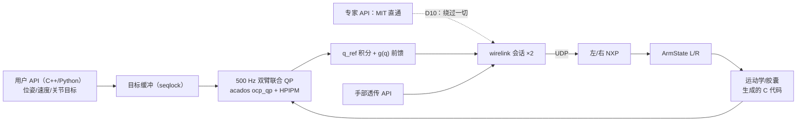

# Panthera 双臂空间控制 SDK：执行计划（v4.1，2026-11-20，交接版）

本文是交给执行 agent 的唯一计划来源。§1 是已拍板的决策，不要再改；有疑问先查 §9 的资料位置。涉及 §1 决策变更、实机上电/运动动作或安全边界调整的未决项由负责人确认；其余按对应工作包的验收条件推进。

## 1. 已确认决策

| # | 决策 |
| --- | --- |
| D1 | 只做 **acados QP（HPIPM）**，500 Hz 任务空间控制；**不做 NMPC**，也不做非线性 MPC |
| D2 | 交付**独立仓库** `panthera-spatial-sdk`；C++ 核心 + **pybind11** Python 接口；上位机不限平台 |
| D3 | **双臂自碰撞**进入 QP 约束；最小距离低于硬阈值时主机软停 |
| D4 | 模型：Panthera-HT 六轴 + A2/L1 灵巧手。两手都相对工具轴 **pitch 向上 45°**，两臂中心距 **480 mm**，平行安装。已完成，见 `model/panthera_dual_description` |
| D5 | 转接件实际存在，暂按**厚度 0、质量不计** |
| D6 | 交付固件：左臂 **node11** / `192.168.10.11` / UDP 5005-5006；右臂 **node12** / `.12` / 5015-5016；主机 node10 / `192.168.10.1` |
| D7 | 固件基线：**dual-gello 11.20 源码**，新增 **host-control 构建配置**；遥操构建保留，但不作为交付默认 |
| D8 | 依赖固化：Zephyr 侧固化 `west.yml` 精确提交和补丁；主机侧**能用 git submodule 固定提交的就用 submodule**，做不到才 vendor |
| D9 | acados 固定到**最新正式版 tag**（2026-11-20 已核对为 v0.6.1） |
| D10 | 专家模式：**关节 MIT 完全直通，不做任何监控**（不跑 QP、不检查碰撞、不限幅）；默认关闭，文档里明确标注风险 |
| D11 | 灵巧手：SDK **透传 6 个主动关节的目标和状态**；碰撞模型里手部用**覆盖全部手指行程的保守包络**，与手指当前状态无关 |
| D12 | 重力：先用 URDF 名义惯量（含真实手部 0.617 kg）。旧的辨识参数是在“link6 集中 620 g”模型上拟合的，不能直接套用，以后重新辨识 |

## 2. 系统现状（执行者必须知道的事实）

### 2.1 链路与协议
- PC ↔ 每块 NXP 走 UDP + wirelink（CRC32C），schema revision **7**。协议源是 `protocol/robot_messages.wl` 和 `*.bind.wl`；两套固件里的协议与生成代码逐字节一致。
- **实时通道**（左 5005 / 右 5015）：
  - 主机 → 板：`ArmCommand`(257)，30 个 float，即 6 关节 × `[q, dq, kp, kd, tau_ff]`，加 `joint_mask`；`HandCommand`(258)；`HandComplianceCommand`(259)。不可靠投递，最新值覆盖。
  - 板 → 主机：`ArmState`(513)，默认周期 2000 µs；`HandState`(514)，10 ms；`FaultSnapshot`(515)，50 ms；`Diagnostics`(516)，100 ms。
- **管理通道**（左 5006 / 右 5016）：可靠 RPC，`Operation`(1025/1026)、`Configure`(1027/1028)，以及 `FaultEvent`(769) 队列。
- **主机端口绑定**：固件把遥测发到主机 IP 的**同号端口**。主机必须 bind 5005/5006/5015/5016 四个本地端口，可参考 `robot_sdk.py`。
- **会话流程**（参考实现：`Panthera-DualNXP-Hyperhands` 的 `source/host/robot_sdk.py` 与 `source/host/arm_lab.py`，按 `dual-gello` 固件接管条件 1:1 移植）：
  1. **discover 与能力探测**：收到两板 `ArmState` 取 `source_boot_id` 与 `policy_revision`；发 `op19` 确认固件支持柔顺停止与主机看门狗。
  2. **开启电机 CAN 轮询并等新鲜反馈**：固件默认 `hand_isolation=true`，接管离开 `HOME_HOLD` 后若未关闭会跳过手臂 CAN 轮询导致失联。先发 `op10`（`motor_query_hz=500`、不置位 `hand_isolation`），等待两板均拿到新鲜 6 轴反馈（`online/valid_q/valid_dq/valid_tau/motor_fault_valid` 掩码均为 63、`fault_code_raw` 全 0、总延迟 `max(feedback_age_us) + host_rx_age < 20 ms`、数值有限）。
  3. **等回零、申请租约与配置**：轮询 `op1` 申请租约（`BOOT_HOME=y` 回零未结束时返回 `-16`）；发 `op13(target_mask=0)` 关闭 `zero_mit_load` 并确保 `hand_isolation=false`；按需发 `Configure`（`expected_policy_revision` → `new_policy_revision`）；冻结普通模式的整圈编码器偏移 `encoder_zero_rad`。
  4. **预发保持帧再激活 `op3`**：`HOME_HOLD` 下板端 `op3` 要求已收到 `joint_mask=63`、帧龄 `< 20 ms` 的 `ArmCommand`，且各轴 `|q_cmd − q_meas| ≤ 2°`、`|dq_cmd| ≤ 3°/s`、`kp/kd ≥ 0`。先向实时端口发当前姿态保持帧（`q_raw = q_meas_raw`、`dq = 0`、`tau_ff = g(q_model)`），再向管理端口发 `op3`；因实时与管理分属独立 UDP socket 可能乱序，遇 `-16` 且 `control_owner == 2` 时每 2 ms 补发保持帧并重试 `op3`（上限 100 ms）。**若一侧激活成功而另一侧失败，立即向已激活侧发 `op18` 软停并停止发帧（未激活侧按需 `op2` 释放）**。
  5. **500 Hz 运行与退出**：每 2 ms 发一帧 `ArmCommand`（带 lease、policy、`target_boot_id = 板子启动 ID`、递增 sequence）。软停退出（`op18`）后**不要**发 `op11`（`op11` 会重设 `hand_isolation=true`）。
- **其余操作码**：op2 释放，op9 失能关节，op10/11 开关状态流，op13 关零负载覆盖/解除隔离，op17 主机停止，op18 软停，op19–22 能力探测。
- **板端兜底**：主机指令 ≥ 50 ms 未更新（`robot.arm_at` 超时）就自动软停（需要 `LOCAL_HOME=y`）。固件本身没有应用层限幅（D10 的直通即依赖这一点）。
- **固件时序**：控制任务 500 Hz；CAN 每 333 µs 轮询一个电机，每个电机 500 Hz。网络往返（旧 Python 测量）p50 1.8 ms、p99 6.1 ms。
- **单位**：q rad、dq rad/s、kp Nm/rad、kd Nm·s/rad、tau Nm。默认增益取 `dual-nxp.json`：kp `[24.48, 61.2, 61.2, 12.24, 12.24, 12.24]`，kd `[1.2, 1.92, 1.92, 0.48, 0.48, 0.48]`。
- **关节坐标与整圈偏移**：除去整圈偏移后编码器坐标 = URDF 坐标（sign 全 1、offset 全 0）。旧配置 `encoder_modulo_joints: [2]` 按 1-based 轴号 `1..6` 索引（`joint − 1`），指 **J2**（不是 J3），见 `运行参数.py` 与 `arm_lab.py`；固件 `home_path.c` 也按 `branch_reference` 为各轴选定整圈零位 `zero[i] = 2π·floor((q_raw − branch_ref)/2π + 0.5)`。主机普通模式在 `enable()` 激活前按新鲜反馈与固件分支规则冻结 `encoder_zero_rad`（整圈 `2πk`）：读状态做 `q_model = q_raw − encoder_zero_rad`（相邻原始角跳变 `> π` 立即报错软停），发 `ArmCommand` 做 `q_raw = q_model + encoder_zero_rad`；专家模式（D10）保持原始编码器坐标直通。实机需核对两板实际回绕轴号与回零分支。
- **灵巧手**：`HandCommand.target_q_rad[6]` 的顺序是拇指旋转、拇指弯曲、食指、中指、无名指、小指（固件 `hand_joints.h`），对应 URDF 的 `*_thumb_cmc/thumb_pip/index_mcp/middle_mcp/ring_mcp/little_mcp`。**符号、比例、零位未核对**，属于 WP-B/WP-H 的任务。`HandState.joint_q_rad[11]` 是含被动关节的完整反馈。

### 2.2 固件 host-control 构建（新增）
- 配置组合：`local-workspace.conf; dual-common.conf; boards/{left,right}.conf`。不叠加 `gello-standalone*`、`gello-radio*`、`gello-web`；右板要显式设 `CONFIG_ROBOT_GELLO_USB=n`。保留 `LOCAL_HOME=y`、`BOOT_HOME=y`、`PEER_LINK=y`。
- 不带 `GELLO_STANDALONE_ACTUATE` 时，板端才接受主机申请租约。
- **风险**：dual-gello 基线从未在 host-control 模式下验收过；11.6 冰封版是 PC 主控、已经在实物上跑过。差异约 20 个文件，需要在实机上回归。

## 3. 架构



### 3.1 控制环
- 主机时钟驱动 500 Hz，每周期取两臂最新 `ArmState`，状态年龄按 `max(feedback_age_us) + host_rx_age` 计算，并校验 6 轴在线/有效/无故障及 `control_owner != 2`。
- **双臂联动陈旧与单向断链处理**：
  - 任一臂状态超过 **10 ms** 未更新（或校验不通过）：**双臂同时冻结**联合目标（两臂均保持上一帧 `q_ref`、`dq = 0`）并上报警告，防止在线臂基于失联臂旧姿态运动。
  - 任一臂状态超过 **50 ms**、出现故障或意外切回板端控制时，主机立即停发两臂运动命令，并向仍持有有效会话的两板请求 `op18`。若软停请求未送达，处于主机控制的板从最后一帧被接受的 `ArmCommand` 起计满 50 ms 触发看门狗。仅上行中断时，冻结期间的保持帧仍会刷新该计时。板端反馈有效时进入 `HOME_SOFT_HOLD`；反馈失效或电机故障时按固件进入 `HOME_FAULT`，SDK 上报实际可确认的状态。
  - **单板意外重启**：检测到新的 `source_boot_id` 后，主机停发双臂运动命令，作废重启侧旧租约与待发目标，向仍在线的另一板请求 `op18`，并上报重启事件。允许重启板按现有固件 `BOOT_HOME=y` 自动回零。调用方再次显式调用 `enable()` 并完成双板接管后，才能恢复联合控制。
- **输出与参考状态**：维护内部参考状态 `q_ref`（`enable()` 激活时初始化为 `q_meas`），QP 直接求解 `x1 = q_ref + dt·q̇*`，下发 MIT `[x1, q̇*, kp, kd, g(q_meas)]` 并更新 `q_ref ← x1`（普通模式下发前加回 `encoder_zero_rad`）。
- **六轴重力前馈 `g(q)`**：按单臂 URDF 离线生成 6 轴函数，**固定手指构型为中立张开位 `q_hand = 0`**（不耦合 10 ms 手状态；按左臂零位模型计算，6 个主动手关节由 0 变至 0.5 rad 时，J2 重力矩变化约 0.022 N·m）。

### 3.2 QP 形式（acados `ocp_qp`，N = 1）
- **变量**：`x0 = q_ref`（12 维，当前参考位置），`u = q̇`（12 维），`x1 = x0 + dt·u`（dt = 2 ms），确保 QP 约束的状态与实际下发的 MIT 目标一致。运动学雅可比与碰撞距离按当前测量姿态 `q_meas` 计算。
- **代价**：

$$
\sum_{i\in\{L,R\}} \big\|J_i\,\dot q_i - v_i^*\big\|^2_{W_i} + \lambda\|\dot q\|^2 + \mu\|\dot q - \dot q_{\text{prev}}\|^2 + \text{零空间姿态项}
$$

  其中 `v* = Kp·log(T⁻¹T*) + v_ff`。
- **约束**：
  - `x1` 的关节限位取 URDF 值（含 WP-C 确认的近距同臂软限位），按速度阻尼收紧，并叠加相对 `q_meas` 的滞后防饱和界 `|x1 − q_meas| ≤ e_lead_max`（超跟踪故障阈值则双臂软停）。
  - `|u| ≤ v_max`，`|u − u_prev| ≤ a_max·dt`。
  - 碰撞：固定 **K = 16** 个通用约束槽位：

$$
n^\top\big(J_a - J_b\big)\,\dot q \ge -\xi\,\frac{d - d_s}{d_i - d_s}
$$

    臂间默认 `d_s = 0.02 m`，`d_i = 0.10 m`，`ξ = 0.5 m/s`；同臂按 WP-C 生成的逐对参数（见 §3.3）。对启动时距离已低于其 `d_s` 的同臂近距对（如零位下的 `link2↔link5`），将右端下界截断至 `0`（仅禁止继续靠近、允许抬臂远离），避免在零位把臂推向关节限位。
  - **16 槽下发前全对复核**：每周期先按距离/裕度选 16 对求解（空槽位填宽松界）；下发前用候选解 `u*` 检查**其余所有进入 `d_i` 的启用胶囊对**，若有违约对则换入 16 槽重解（限 1–2 次且在周期预算内）；仍违约或超时即走 QP 失败路径。
- **求解器**：`FULL_CONDENSING_HPIPM`，热启动；目标 p99 < 100 µs。
- **QP 不可行、复核仍违约或超时**：本周期双臂保持 `q_ref`、`dq = 0`；连续 5 次失败则双臂 `op18` 软停并停发 `ArmCommand`。

### 3.3 碰撞模型
- **配对来源**：`srdf/panthera_dual_a2l1.srdf` 中保留的配对（819 对，其中臂间 573 对），合并到胶囊级别。
- **臂连杆**：每个连杆 1–2 个胶囊，用离线工具从 STL 拟合（PCA 定轴 + 最小包围半径优化），要求**完全包住网格**。
- **手（D11）**：覆盖 **URDF 主动关节全行程**（6 个主动关节全范围；当 `mimic` 倍率导致从动关节超限时按从动 URDF 限位截断，严格包含 `mimic_compatible_driver_limits_rad`）。各指独立做 1D/2D 密采样（四指 1-DOF、拇指 2-DOF），把手掌坐标系下点云取并集拟合 2–3 个胶囊（掌、四指扫掠、拇指扫掠），并在半径上叠加**连续运动解析位移上界余量 `δ_step`**；实机机械端点在 WP-H 核对。
- **运行时**：解析的线段–线段距离，不链接 coal/FCL；coal 只用于离线校验。
- **分层阈值与零位接管兼容**：保持固件回零停在 `zero`（不改固件回零逻辑）。实测网格距离显示：臂间 573 对在 `zero`/`ready`/`home_waypoint` 下均 ≥ 246.6 mm，但同臂 `link2↔link5` 在 `zero` 仅 **0.204 mm**（`j2=j3=5°` 即拉开至 20.5 mm），且同臂 `link4↔palm_base_link` 在三姿态下均为 **6.5–6.8 mm**（`|j5| ≥ 75°` 接触）。因此：
  - **臂间胶囊对**统一采用 `d_s = 0.02 m`、`d_i = 0.10 m`、`d_hard = 0.005 m`。
  - **同臂胶囊对**由 WP-C 验收 `zero`、`ready`、固件 `home_waypoint` 三姿态下的实际胶囊间距后生成逐对配置（`d_s`、`d_hard`），确保三姿态均不误触硬停且能从 `zero` 平稳抬臂；对 `link4↔palm_base_link` 等腕部近距对，辅以收紧 J5 软限位（如 `±60°`）。任意启用配对低于其 `d_hard` 时，主机向两板执行 `op18` 软停并停发 `ArmCommand`。

## 4. 仓库结构（目标）

```text
panthera-spatial-sdk/
├─ docs/                     PLAN.md（本文）、API、协议、安全说明
├─ model/panthera_dual_description/   ✅ URDF/SRDF/网格/配置/校验
├─ tools/
│  ├─ model/                 ✅ build_description.py、verify_description.py
│  └─ codegen/               urdf→C（Pinocchio+CasADi）、胶囊拟合、wlc 重生成（仅离线使用）
├─ protocol/                 robot_messages.wl + *.bind.wl（从固件同步，CI 校验一致）
├─ generated/                已提交：wlc 编解码器、运动学/重力/雅可比 C 代码、胶囊参数
├─ firmware/                 dual-gello 11.20 应用源码 + host-control 配置 + 构建/烧录脚本
│  └─ zephyr/                west.yml（精确提交）+ zephyr-network.patch + gello_usb_ehci.cmake
├─ third_party/              git submodules（见 §5），VERSIONS.md 记录提交/哈希/许可
├─ include/panthera/  src/   transport / session / kinematics / collision / qp / controller
├─ python/                   pybind11 模块 panthera_sdk（scikit-build-core 打包）
├─ sim/                      模拟板：同一协议的 UDP 回环与简化动力学
├─ examples/  tests/
└─ CMakeLists.txt            CMake ≥ 3.22，C++20
```

## 5. 依赖固定方式（D8）

| 依赖 | 方式 | 固定点 | 备注 |
| --- | --- | --- | --- |
| wirelink 核心 | submodule `starwey604/wirelink` | **`608551b3`**（2026-09-22） | 该提交的 `include/wirelink` 和 `src` 两棵树（`ccaa46c3` / `3b3e9ad5`）与固件内置副本**完全一致**，已核对。主机和固件都改用 submodule，CI 校验树哈希 |
| WLC 0.8.0 | submodule `starwey604/wlc` | `758d12a2`（源码包 SHA256 `c97fa894…`） | 只在重生成协议时需要；生成物已提交；CI 断言摘要与 `robot_messages_manifest.json` 一致 |
| acados | submodule | 最新正式 tag | 它自带的 hpipm/blasfeo 子模块按 tag 固定；构建时只开 HPIPM |
| Eigen | submodule | 最新 3.4.x 或 5.x 稳定 tag | 头文件库 |
| pybind11 | submodule | 最新稳定 tag | |
| Zephyr / hal_nxp / CMSIS / segger | `firmware/zephyr/west.yml` | 精确提交（取自 dual-gello `toolchain/west.yml`） | 外加网络补丁；不入库 |
| Pinocchio / CasADi | 不入库 | `tools/codegen/requirements.txt` 固定版本 | 只在离线生成时用 |

> [!WARNING]
> `starwey604/wirelink` 和 `starwey604/wlc` 对外部用户是否可访问需要核实。不可访问时，按 D8 退回 vendor：拷贝上面固定提交的源码，并在 VERSIONS.md 记录来源。

## 6. 公共 API（草案，执行时可细化，语义不变）

```cpp
namespace panthera {
auto robot = DualArm::connect(Config::fromFile("config/dual_arm.yaml"));
robot.enable();                                   // discover/op19 → op10 开轮询等反馈 → op1/op13/configure → 冻结整圈偏移 → 预发保持帧 → op3 激活
robot.setPoseTarget(Arm::Left, T, twist_ff);      // 任意线程、任意频率
robot.setTwistTarget(Arm::Right, twist);
robot.setJointTarget(Arm::Left, q);               // 仍经过 QP 和碰撞约束
robot.setHandTarget(Arm::Left, q6, duration_ms);  // 透传（D11）
State s = robot.state();  // q/dq/tau、TCP 位姿、最小碰撞距离与配对、QP 状态、时延统计、故障
robot.softStop(); robot.disable();
// 专家模式（D10）：显式开启，完全直通，不做任何监控
auto raw = robot.enterExpertMode(ExpertAck::IUnderstandNoSafety);
raw.sendMit(Arm::Left, q, dq, kp, kd, tau);
}
```

Python 版本 `panthera_sdk` 与 C++ 一一对应，命名用 snake_case，位姿用 numpy 4×4 矩阵，6 维向量用 numpy 数组。

## 7. 工作包（可并行，括号内为依赖）

| WP | 内容 | 验收 |
| --- | --- | --- |
| A 骨架与依赖 | §5 的全部 submodule、VERSIONS.md、顶层 CMake、CI（Linux x86_64 + Windows x64 为一级平台，macOS arm64 / Linux aarch64 为二级）、clang-format | 全新克隆加 `--recursive` 后一条命令构建通过；CI 绿；wirelink 树哈希断言通过 |
| B 通信与会话（A） | C++ 传输层与 wirelink 会话（按 §2.1 完整接管顺序移植 `robot_sdk.py`/`arm_lab.py` 语义：含 `op10` 解除 `hand_isolation`、`op13`、预发保持帧与 `op3` 乱序重试、单侧失败联动 `op18`、整圈偏移收发转换与跳变保护）、双板、时延统计、`sim/` 模拟板、手部透传 | 对模拟板跑全流程与异常测试（单板重启后允许板端自动回零、在线侧收到软停请求、双臂停发且须显式重新使能，另覆盖丢包、旧包、RPC 超时、实时帧与 RPC 乱序、一侧激活失败回滚另一侧、非零整圈偏移 `±2π` 往返、仅丢一路上行遥测而下行正常的单向断链）；模拟板 500 Hz 下无丢周期 |
| C 模型代码生成（A） | 从单臂 URDF 生成 CasADi C：FK、雅可比、`g(q)`（固定 `q_hand = 0`）；胶囊拟合（臂 + 手全主动行程包络加连续余量 `δ_step`）；输出 `zero`/`ready`/`home_waypoint` 三姿态胶囊间隙报告与同臂逐对阈值/J5 软限位配置；`generated/` 入库 | 与 Pinocchio 误差 < 1e-9（`g(q)` 同在 `q_hand = 0` 下对比）；胶囊逐顶点完全包住网格；手包络含 `δ_step` 覆盖主动全行程；三姿态下均不触发硬停且 `zero` 抬臂可行 |
| D 碰撞与 QP（C） | 胶囊距离、最近 K=16 对选择与下发前全对违约复核重解、acados `ocp_qp` 封装（`x0 = q_ref` 与防滞后饱和界）、初始默认 QP 参数（权重/`v_max`/`a_max`/`e_lead_max`）、不可行处理 | 求解 p99 < 100 µs（x86_64）；仿真里两臂对冲停在 `d_s` 以外；随机目标从不穿透；覆盖“>16 对同时进入 `d_i` 且第 17+ 对闭合最快”及“实测滞后靠近关节上限时输出 `x1` 不越限”用例 |
| E 控制器（B、D） | 500 Hz 环、目标插值、统一 `q_ref` 积分与下发、`g(q)` 前馈、双臂联动陈旧冻结（10 ms）与单向断链双板 `op18`+停发帧（50 ms）、软停策略、专家模式 | 模拟板双臂闭环跟踪工作空间内限速/限加笛卡尔直线与阶跃轨迹，稳态 TCP 位置误差 < 2 mm、姿态误差 < 1° 且无越限/无穿透；所有降级路径（含 §3.1 重启后的双臂停发与显式恢复、单向遥测断链、板端故障、滞后逼近上限、QP 连续失败）有测试 |
| F Python 与文档（E） | pybind11 绑定、wheel、示例（读状态、笛卡尔移动、双臂靠近自停、手部透传、专家模式）、文档 | wheel 在一级平台可安装；示例对模拟板跑通 |
| G 固件导入（A） | 导入 dual-gello 11.20 应用源码，改为引用 wirelink submodule；新增 host-control 配置；构建与烧录脚本；预编译镜像 + SHA256 | 两块板的 host-control 镜像在固定 west 版本下可复现构建；原生单元测试全过 |
| H 实机验收（E、G，需人在场） | 只读 500 Hz 时延/丢包；单臂单关节小幅；手部映射符号及机械端点行程核对；核对两板实际整圈回绕轴号（当前配置 1-based `[2]` 即 J2）与固件 `home_path.c` 回零分支；双臂靠近自停；1 小时稳定性 | 结果记录在 `validation/` |

## 8. 仍待定（不阻塞开工，执行中按默认处理）

1. **TCP**：默认取 `palm_base_link` +z 0.100 m（占位值），可在 `dual_arm.yaml` 调整。
2. **两底座共面且平行**：默认按是处理。
3. **重新辨识重力**：放在 WP-H 之后，作为独立任务。
4. **QP 参数**（权重、`d_s`/`d_i`/`ξ`、`v_max`/`a_max`/`e_lead_max`）：碰撞参数取 §3.2（同臂逐对阈值按 WP-C 三姿态验收结果写入配置）；WP-D 给出任务权重、`v_max`、`a_max`、`e_lead_max` 的初始默认配置，供 WP-E 仿真验收使用，实机调参后写回配置。

## 9. 资料位置

| 内容 | 路径 |
| --- | --- |
| 固件基线 | `/home/ww/codings/dual-gello`（README 交接速查、`boards/`、`toolchain/west.yml`、`source/src/{core/controller.c,devices/can_bus.c,homing/{homing.c,home_path.c,local_home.c}}`） |
| 11.6 PC 主控固件与 Python SDK 参考 | `/home/ww/codings/Panthera-DualNXP-Hyperhands`（根目录 `dual-nxp.json`、`运行参数.py`；`source/host/{robot_sdk.py,robot_protocol.py,arm_lab.py}`） |
| wirelink / WLC | `/home/ww/codings/wirelink`（固定提交 `608551b3`）；WLC：`github.com/starwey604/wlc@758d12a2` |
| 前作 C++ SDK（acados 用法、URDF→C、pybind11 结构） | Panthera-DualNXP 中 `source/host/examples/遥操资料_20261030_完整版(2)/…/Ragtel_遥操作GUI/sdk/fci`；`/home/ww/codings/libflorid` |
| 灵巧手原始模型 | `/home/ww/codings/L1_Hand/A2L1Description`（已拷入 `model/…/sources/a2l1_hand`） |
| 工控机环境 | 见 dual-gello README“交接速查”：绿盾 DLP、内核固定、ASan 绕过方法 |
