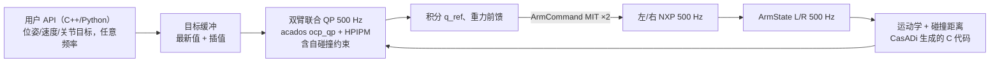

# Panthera 双臂空间控制 SDK：总体计划（v3，2026-11-20）

> 已定：**不用 NMPC**，用 acados 的 QP 接口（HPIPM）做 500 Hz 任务空间控制；需要双臂自碰撞检查；对外交付一个**独立代码仓库**，源码全部固化在仓库内；提供 C++ 接口和 pybind11 Python 接口；上位机不限平台。固件限幅、重力补偿按你的说法不作为风险项。

## 1. 新工作区探索结论（Panthera-DualNXP-Hyperhands）

| 项目 | 发现 | 对计划的影响 |
| --- | --- | --- |
| 协议 | `robot_messages.wl`、`generated/`、`third_party/wirelink` 与 dual-gello **逐字节一致**（schema rev 7） | 一个主机核心能同时对接两套固件 |
| 架构 | [dual-nxp.json](file:///home/ww/codings/Panthera-DualNXP-Hyperhands/dual-nxp.json)：“PC 负责 GELLO 映射、回零和重力”，臂 500 Hz、手 50 Hz；左板 5005/5006，右板 5015/5016 | 本 SDK 走这种 PC 主控模式 |
| Python SDK | [robot_sdk.py](file:///home/ww/codings/Panthera-DualNXP-Hyperhands/source/host/robot_sdk.py)：discover → lease（op1）→ configure → active（op3），按 2 ms 发 `ArmCommand` | C++ 核心照这套状态机移植 |
| URDF | [PantheraHT_v4_hand620g.urdf](file:///home/ww/codings/Panthera-DualNXP-Hyperhands/source/host/Assets/PantheraHT_v4_hand620g.urdf)，碰撞体是 7 个 STL 网格；**灵巧手没有几何体**，只有 620 g 质量 | 需要拟合胶囊体，手部几何要补测 |
| 重力 | [arm_dynamics.py](file:///home/ww/codings/Panthera-DualNXP-Hyperhands/source/host/arm_dynamics.py) 用 Pinocchio 回归矩阵 × θ（24 个参数），已有辨识结果 `profiles/gravity_selected.json`，编码器到 URDF 的映射是 sign/offset | 生成 C 代码直接复用这组参数 |
| 双臂安装位姿 | 仓库里**没有**两臂底座之间的变换 | 自碰撞检查必须有这个变换，需要测量或标定 |
| 前作 | `Ragtel_遥操作GUI/sdk/fci`（libflorid）：C++20、pybind11、`urdf2traits.py`（CasADi 生成 FK/J/M/C/g）、acados 笛卡尔 MPC | 代码生成工具链和绑定结构可以借鉴 |
| wirelink | 固件里内置的版本 ≈ **v0.8.0**，带三处本地补丁（`version.h` 加了 codegen contract，`port.h`/`rx_ring_bipbuf.c` 的 DMA claim 改成 1 个） | 交付仓库直接拷固件里这份，**不用上游新版**（上游已经重构 API、版本号重置到 0.0.99） |
| WLC | manifest 写的是 WLC **0.8.0**（codegen ABI 32）；源码固定在 `starwey604/wlc@758d12a2`（tar SHA256 `c97fa894…`），本机**没有缓存** | 需要联网拉取一次并校验哈希，同时把 Rust crate 依赖 vendor 进来，保证离线可构建 |

## 2. 控制架构与频率



- **单一 500 Hz 控制环**，以两臂 `ArmState` 到达为节拍（取较新的一侧，超过 1 个周期未更新就用预测值补）。
- 决策变量 `u = q̇_cmd ∈ R¹²`（两臂联合求解，因为碰撞约束把两臂耦合在一起）。
- 输出：`q_ref += q̇*·dt`，下发 MIT 帧 `[q_ref, q̇*, kp, kd, τ_ff = g(q)]`。

### QP 形式（每周期一次）

$$
\min_{\dot q}\ \sum_{i\in\{L,R\}} \|J_i(q_i)\dot q_i - v_i^*\|^2_{W_i} + \lambda\|\dot q\|^2 + \mu\|\dot q - \dot q_{\text{prev}}\|^2 + \text{零空间姿态项}
$$

约束：
- 关节位置：速度阻尼形式，`(q_min − q)/dt·α ≤ q̇ ≤ (q_max − q)/dt·α`。
- 速度和加速度：`|q̇| ≤ v_max`，`|q̇ − q̇_prev| ≤ a_max·dt`。
- **自碰撞**：对每一对胶囊体 `(a, b)`，

$$
n_{ab}^\top\big(J_a(q)\dot q - J_b(q)\dot q\big) \ge -\xi\,\frac{d_{ab} - d_s}{d_i - d_s}
$$

  `d_s` 是安全距离，`d_i` 是影响距离，`n` 和 `J` 取最近点处的值。

- `v_i* = K_p·log(T_i⁻¹T_i*) + v_ff`：位姿伺服，带前馈。
- acados 的 QP 维度必须固定，所以碰撞约束固定 **K 个槽位**（默认 K=16），每周期按距离选最近的 K 对填入；空槽位填宽松界。
- 规模：12 个变量，约 52 个约束。HPIPM 预估每次求解 **< 50 µs**，以 P0 实测为准。
- 默认 N=1（瞬时 QP）。acados `ocp_qp` 本身支持多步，以后需要加速度平滑时可以开 N>1 的线性 QP，但**不引入非线性 MPC**。

### 自碰撞模型

- 模型：[panthera_dual_description](../model/panthera_dual_description/README.md)（**已完成**）。整机 URDF + SRDF 碰撞矩阵：48 个碰撞体，819 对保留检查，其中臂间 573 对全部保留。
- 500 Hz 运行时：每个连杆用 1–2 个**胶囊体**近似，从同一套 STL/OBJ 网格离线拟合（P2 工具），手掌和手指整体包络为 2–3 个胶囊体。
- 配对来源：SRDF 中保留的配对，合并到胶囊级别（手内部不检查）。
- 胶囊–胶囊距离用解析的线段–线段算法，运行时**不引入 FCL/coal**（coal 只在离线校验中使用）。
- 双臂底座位姿：`model/panthera_dual_description/config/dual_arm.yaml`（中心距 480 mm，平行安装）。
- 最小距离低于硬阈值时，主机直接执行软停（`op 17/18`），作为最后一道防线。

## 3. 交付仓库结构

```text
panthera-spatial-sdk/
├─ firmware/                 NXP Zephyr 应用源码、boards、构建脚本、预编译 bin + SHA256
├─ protocol/                 robot_messages.wl + *.bind.wl（唯一协议源）
├─ third_party/              全部源码固化，带 VERSIONS.md（来源/提交/哈希/许可）
│  ├─ wirelink-0.8.0/        固件里那份（含三处补丁）
│  ├─ wlc-0.8.0/             Rust 源码 @758d12a + cargo vendor 依赖（离线可构建）
│  ├─ acados/                裁剪后只留 core + hpipm + blasfeo
│  ├─ eigen-3.4.0/
│  ├─ pybind11-2.13.x/
│  └─ zephyr-pins/           west.yml + zephyr-network.patch（是否整份固化见第 6 节）
├─ generated/                已提交的生成物：wlc 编解码器、运动学/重力/雅可比/胶囊 C 代码
├─ model/
│  └─ panthera_dual_description/   ✅ URDF/SRDF/网格/配置/来源/校验（ROS 包结构）
├─ tools/
│  ├─ model/                 ✅ build_description.py、verify_description.py
│  └─ codegen/               urdf→C（Pinocchio+CasADi，仅离线使用）、胶囊拟合、wlc 重生成
├─ include/panthera/         公共 C++ 头文件
├─ src/                      transport / session / kinematics / collision / qp / controller
├─ python/                   pybind11 模块 panthera_sdk
├─ sim/                      模拟板：用同一份 UDP 协议回环，CI 和无硬件开发用
├─ examples/  tests/  docs/
└─ CMakeLists.txt            一条命令构建，不依赖网络和系统包
```

**运行时依赖只有**：wirelink C 核心、生成的编解码器、acados/HPIPM/BLASFEO、Eigen、pybind11（可选）。Pinocchio/CasADi 只在 `tools/codegen` 离线使用，生成物已提交，用户不需要安装。

## 4. C++ / Python 接口草案

```cpp
auto robot = panthera::DualArm::connect("config/dual_arm.yaml");
robot.enable();                                   // discover → lease → configure → active
robot.setPoseTarget(panthera::Arm::Left, T_goal); // 任意线程、任意频率
robot.setTwistTarget(panthera::Arm::Right, twist);
robot.setJointTarget(panthera::Arm::Left, q);
auto s = robot.state();  // q, dq, tau, 末端位姿, 最小碰撞距离及配对, QP 状态, 时延统计
robot.softStop();        // 板端柔顺保持
```

```python
import panthera_sdk as ps
r = ps.DualArm.connect("config/dual_arm.yaml"); r.enable()
r.set_pose_target(ps.Arm.LEFT, T)   # numpy 4x4
```

- **内部线程**：RX/控制线程（实时优先级，固定 500 Hz）、管理 RPC 线程；用户线程只写目标缓冲（seqlock），不会阻塞控制环。
- **平台适配**：Linux 用 SCHED_FIFO + mlockall；Windows 用高精度可等待定时器 + `timeBeginPeriod(1)`；macOS 尽力而为。BLASFEO 在 x86 上选 `X64_AUTOMATIC`，ARM 上选 `ARMV8A`，其他平台回退 `GENERIC`。

## 5. 分阶段计划

| 阶段 | 内容 | 验收 | 状态 |
| --- | --- | --- | --- |
| M0 双臂模型 | 整机 URDF（臂 + A2/L1 手，45° 滚转，中心距 480 mm）、SRDF 碰撞矩阵、校验与预览 | 单臂/整机 FK 一致；零位无自碰撞；SRDF 往返一致 | ✅ 2026-11-20 |
| P0 仓库骨架与依赖固化 | 拷 wirelink（固件那份）；拉取并校验 WLC 0.8.0、cargo vendor；固化 acados/Eigen/pybind11；CMake 离线构建；**用固化的 WLC 重新生成编解码器，与固件 manifest 摘要逐字节一致** | 断网可完整构建；manifest 摘要一致 | |
| P1 通信核心 + 模拟板 | C++ wirelink 主机端、会话状态机（移植 robot_sdk.py）、双板、时延统计；`sim/` 模拟板 | 对模拟板单元测试；实机只读 500 Hz，测出往返时延和丢包 | |
| P2 模型代码生成 | 单臂 URDF → CasADi C（FK、J、g(q)）；胶囊拟合；重力参数对应到新模型 | C 代码与 Pinocchio 误差 < 1e-9；胶囊完全包住网格 | |
| P3 碰撞 + QP | 胶囊距离、最近 K 对选择；acados ocp_qp 联合 QP；求解时间基准 | 求解 p99 < 100 µs；仿真里两臂对冲时停在 `d_s` 外 | |
| P4 控制器集成 | 500 Hz 环、目标插值、q_ref 积分、重力前馈、软停策略 | 模拟板闭环跟踪；实机先单臂小幅、再双臂 | |
| P5 接口与交付 | C++ API、pybind11、示例、文档；把固件源码和预编译镜像放进 `firmware/` | 外部机器从零克隆 → 构建 → 跑模拟示例 | |

## 6. 已确认 / 待确认

已确认（2026-11-20）：
- 不做 NMPC，只用 acados QP。
- 灵巧手用 `L1_Hand/A2L1Description`，绕工具轴偏置 45°。
- 两臂中心距 480 mm。
- 交付独立仓库，源码全部固化；C++ + pybind11 接口；需要双臂自碰撞检查。

待确认：
1. **固件基线用哪份**：新工作区（11.6 冰封版，PC 主控）还是 dual-gello（11.20，含无线遥操和单臂拓扑）？协议相同，区别是 `src/` 里约 20 个文件。
2. **Zephyr/NXP HAL 是否整份固化**：完整源码约 1–2 GB。备选：只固化 `west.yml` 固定提交 + 补丁，外加预编译镜像。
3. **45° 的方向**：当前设定为零位时两只手掌心都朝下且朝内（左 −45°，右 +45°），见 `verification/preview.png`。
4. **转接件厚度/质量、TCP 位置、左右臂与 NXP 节点的对应关系**：见模型 README 的 TODO。
5. **acados 版本**：沿用 libflorid 里那份，还是固定最新正式版？我倾向固定正式版 tag 并裁剪。
6. **用户输入**：只开放笛卡尔位姿/速度和关节目标，还是也开放直接 MIT 透传（绕过 QP 和碰撞检查）？
