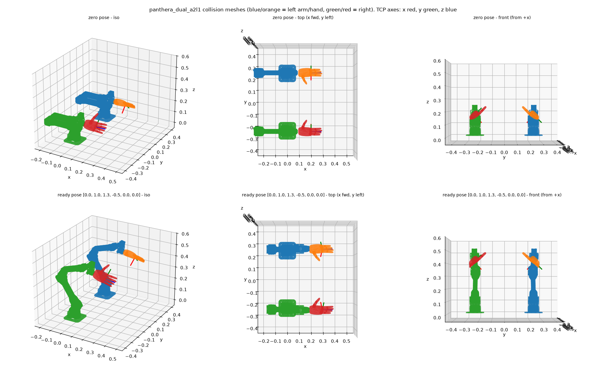

# panthera_dual_description

双臂 Panthera-HT（六轴）+ A2/L1 五指灵巧手的完整模型。供 SDK 的运动学、重力、自碰撞代码生成使用，也可以直接在 ROS 2（RViz/MoveIt）里加载。



## 文件

| 路径 | 内容 |
| --- | --- |
| `urdf/panthera_dual_a2l1.urdf` | 双臂整机，根为 `world` |
| `urdf/panthera_{left,right}_a2l1.urdf` | 单臂 + 手，根为 `{side}_base_link`，供每臂独立代码生成 |
| `srdf/panthera_dual_a2l1.srdf` | 规划组、末端、`zero`/`ready` 姿态、碰撞屏蔽矩阵 |
| `config/dual_arm.yaml` | **唯一可调参数**：间距、手部滚转、法兰/转接件、TCP |
| `meshes/` | Panthera-HT STL/GLB、A2/L1 手 OBJ（原样拷贝） |
| `sources/` | 原始 URDF 与来源记录（**不修改**） |
| `verification/` | `verification.json` 数值校验结果、`preview.png` |

`urdf/` 和 `srdf/` 都是生成物，不要手改。改参数后重新生成：

```bash
python3 tools/model/build_description.py      # 生成 URDF
python3 tools/model/verify_description.py     # 校验 + 生成 SRDF + 预览（约 1 分钟）
```

依赖：Python ≥ 3.10、numpy、PyYAML；校验另需 pinocchio ≥ 3.4（含 coal）、matplotlib。

网格路径使用 `package://panthera_dual_description/...`：
- Pinocchio 中：`package_dirs=[<repo>/model]`
- ROS 2 中：把 `model/` 加入工作区

## 坐标与装配约定

```text
world ── {side}_base_mount_joint (fixed, y = ±0.240 m)
  └─ {side}_base_link … {side}_link6           Panthera-HT 原始运动链，数值逐字拷贝
       └─ {side}_flange_frame                  link6 +x 方向 0.005 m（法兰面）；Ry(+90°)：z = 工具轴
            └─ {side}_hand_mount_frame         绕工具轴滚转 hand_roll_deg；z 方向加转接件厚度
                 └─ {hand}_palm_base_link      源装配 (0, 0, 0.0095) m；之后为 A2/L1 手原始模型
                      └─ {side}_tcp            默认 palm_base +z 0.100 m（占位）
```

- **world**：两底座连线的中点。+x 是两臂共同的前方（Panthera 零位时工具指向 +x），+z 朝上，+y 指向左臂。
- **间距**：底座中心距 480 mm（`base_spacing_m`），两底座平行安装。
- **手部 45°**：左臂 −45°，右臂 +45°。零位时两只手掌心都朝**下且朝内**，即掌心法向 (0, ∓0.707, −0.707)。掌心法向 = `palm_base_link` 的 +x（手指绕 +y 弯向 +x，已自动校验）。
- **关节**：每臂 6 个；每只手 11 个转动关节，其中 5 个 mimic，独立驱动 6 个。用 Pinocchio 加载时**必须** `mimic=True`，这样 nq = 2×6 + 2×6 = 24。
- **质量**：每臂 4.448 kg（不含原装夹爪），每只手 0.617 kg，整机 7.606 kg。转接件质量未知，没有计入。

## 自碰撞矩阵

48 个碰撞体，共 1128 对：

| 处理 | 数量 | 规则 |
| --- | --- | --- |
| Adjacent | 70 | 一个活动关节直接相连（固定链合并后判定） |
| HandInternal | 230 | 同一只手内部的连杆（手指不由本 SDK 控制） |
| Never | 8 | 同臂臂-臂连杆，6000 次随机采样从未接触 |
| Static | 1 | 两个底座（都固定在 world 上） |
| **保留检查** | **819** | 其中**臂间 573 对全部保留** |

- 手对本臂**不会**因为采样从未接触而被屏蔽。
- 零位和 `ready` 姿态下保留的配对均无接触；零位时两臂间最小距离 0.286 m（两拇指之间）。
- 网格碰撞只用于离线校验。500 Hz QP 用的胶囊体近似，在后续阶段从同一套网格拟合。

## 未确认事项（TODO）

1. 手部滚转的正负号（掌心朝内还是朝外），需要对照实物。
2. 法兰到手之间转接件的厚度和质量（目前厚度 0、质量不计）。
3. 左右臂与 NXP 节点的对应关系：`dual-nxp.json` 写 node11 = left，dual-gello 网页里“左手”对应 node12。
4. TCP 位置（目前是占位值）。
5. 两底座是否完全平行、是否共面（目前假设都是）。
6. 现有辨识重力 `sources/panthera_ht/gravity_selected_v4_hand620g.json` 是在“link6 集中 620 g”模型上拟合的。它的 `urdf_sha256` 已核实等于同名派生 URDF 的 CRLF 版本，只是换行符不同，内容相同。本模型改用真实手部惯量，重力参数需要在 SDK 里重新对应（P2）。

## 来源

| 来源 | 版本 | 许可 |
| --- | --- | --- |
| Panthera-HT 机械臂 | [Hyperhands/Panthera-DualNXP-Hyperhands](https://github.com/Hyperhands/Panthera-DualNXP-Hyperhands) `1b192ad4`，`source/host/Assets/PantheraHT.urdf`；上游 HighTorque-Robotics/Panthera-HT_SDK `7c506f88` | MIT（`sources/panthera_ht/LICENSE`） |
| A2/L1 灵巧手 | `~/codings/L1_Hand/A2L1Description`（DVT2 a2 提取，非 git 仓库，文件校验见 `sources/a2l1_hand/source_and_checks.json`） | 见 `sources/a2l1_hand/README.txt` |
